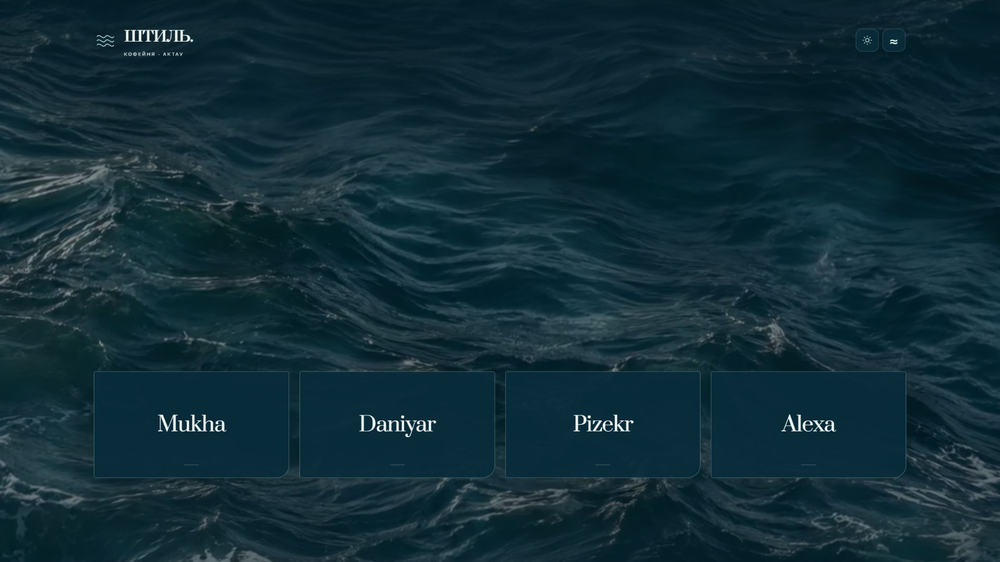

# Штиль · Экран бариста

Главная страница — экран на мониторе кофейни «Штиль» в Актау: только имена бариста на фоне движущегося моря. Нажатие на имя показывает персональный QR. Гость сканирует его и открывает отдельную мобильную форму на своём телефоне. [AdminFeedback](https://github.com/Yernaribadulla/AdminFeedback) использует прежний источник аналитики.

[Открыть экран кофейни](https://yernaribadulla.github.io/qrcode2/) · [Демо без записей](https://yernaribadulla.github.io/qrcode2/?demo=1) · [Демо формы на телефоне](https://yernaribadulla.github.io/qrcode2/feedback.html?staff=mukha&demo=1)



[Мобильная форма](docs/preview-feedback.jpg) · [Форма с выбранной оценкой](docs/preview-mobile.jpg)

## Экран кофейни 2.2

- Убраны вопрос «Кто вас обслужил?», подсказки, аватары с буквами, стрелки, переключатель сценария и ссылки «оставить/открыть отзыв». На главной видны бренд, имена и компактные настройки темы/движения.
- На мониторе четыре имени расположены крупными карточками по ширине, без узкой общей панели. Море занимает основную часть экрана. На узком дисплее имена перестраиваются в две колонки.
- Любое имя открывает QR на этом же экране независимо от ширины и типа устройства. Прежние параметры `?direct=1` / `?kiosk=1` больше не меняют сценарий. Форма доступна по персональной ссылке, закодированной в QR.
- Вода движется локально: собственный WebGL-шейдер деформирует фотореалистичную текстуру несколькими полями волн и меняет блики. Это художественный эффект, вдохновлённый Каспием; не видео и не физическая симуляция моря. Обычного сдвига фотографии на мониторе больше нет.
- Рендер ограничен 30 кадрами/с и примерно 1 млн пикселей, независимо от плотности дисплея. В скрытой вкладке и при паузе цикл останавливается. При системном reduced motion графика не запускается; без WebGL или при потере контекста остаётся фотографический фон. При недоступности изображения — резервный морской цвет.
- Светлая/тёмная темы, плавная смена цвета и последовательный fade имён сохранены. Системный reduced motion отключает переходы. Белое поле QR защищено от движущегося фона; код имеет поля, таймер 20 секунд, продление и возврат с восстановлением фокуса.
- Гостевая форма остаётся компактной: сотрудник, оценка, необязательный комментарий, отправка. Ошибка сети сохраняет ввод, повторная отправка во время запроса заблокирована. Рабочие интеграции и адреса не изменены.

Для монитора откройте главную в полноэкранном режиме браузера. Никаких дополнительных параметров URL не требуется. Список сотрудников загружается из действующей таблицы; при сбое показана возможность повторить загрузку, а не выдуманная команда.

[Решения UI](docs/design.md) · [Устройство анимации и ограничения](docs/water-renderer.md) · [Ассет и prompt](docs/water-asset.md)

Тема и пауза используют ключи `shtil-theme` и `shtil-motion`, как AdminFeedback. На одном origin `yernaribadulla.github.io` выбор синхронизируется между сайтами и вкладками. При недоступном storage интерфейс продолжает работать.

## Запуск

Это статический сайт без сборки и серверных npm-зависимостей. Открывайте через HTTP, а не `file://`: приложение использует ES-модули.

```sh
git clone https://github.com/Yernaribadulla/qrcode2.git
cd qrcode2
npm ci
npm start
```

Сервер слушает только [127.0.0.1:4174](http://127.0.0.1:4174/). Для обычного размещения достаточно файлов репозитория; Node.js нужен только для локальных инструментов и тестов. Можно использовать `python -m http.server 8000`.

Добавьте `?demo=1` для проверки интерфейса. Демо явно отмечено, показывает демонстрационную команду, переносит параметр в QR и не выполняет запросов к Sheets, Apps Script или Метрике. Без этого параметра форма при открытии с сотрудником фиксирует настоящий скан.

## Связь с аналитикой

Настройки находятся в [src/config.js](src/config.js). Сохранены исходные spreadsheet ID, `gid=1292898986`, URL Apps Script и счётчик Метрики `110849170` на странице отзыва. Серверный код Apps Script находится вне этого репозитория и не изменялся.

| Событие              | Формат запроса в прежний Apps Script                          |
| -------------------- | ------------------------------------------------------------- |
| Открытие формы по QR | JSON `{ "barista": "mukha" }`, без `rating`                   |
| Отзыв                | JSON `{ "barista": "mukha", "rating": 5, "comment": "…" }`    |
| Переход на платформу | URL-encoded `type=platform_click&barista=mukha&platform=2gis` |

Поддерживаются `feedback.html?staff=...` и прежний `?barista=...`. QR сохраняет путь `qrcode2/feedback.html` на действующем домене. Идентификатор сотрудника формируется, как раньше: имя в нижнем регистре. Внешние строки вставляются через `textContent`. При отсутствии сотрудника сохраняется прежнее значение `unknown`; в AdminFeedback такие записи не относятся к конкретному сотруднику.

Скан защищён от повторов в одной сессии ключом `scan_logged_<имя>`. Отклонённый сетевой запрос снимает эту отметку. При заблокированном sessionStorage запись скана работает, но межстраничная дедупликация недоступна.

Apps Script по-прежнему вызывается с `mode: no-cors`. Его opaque-ответ **не позволяет подтвердить сохранение строки**. Сетевая ошибка оставляет форму для повтора; экран благодарности появляется после завершения запроса без сетевого исключения. Для подтверждения записи нужен отдельный ответ backend с разрешённым CORS; это не имитируется на клиенте.

## Проверки

```sh
npm ci
npx playwright install --with-deps chromium
npm run format:check
npm test
npm run test:browser
```

10 unit-тестов: парсинг GViz, идентификаторы, старые ссылки, схемы запросов, валидация, демо и ошибки сети. 32 браузерных сценария: декодирование QR, таймер/продление, фокус, клавиатура и касание, отказ источника и генератора QR, повторная отправка, XSS, обе темы, форма и благодарность. axe проверяет WCAG A/AA/2.1 AA в обеих темах. Проверены ширины 320/390/768/1440 px, монитор 1280×720 и 1920×1080, отсутствие призывов к отзыву на главной, анимация/пауза/возобновление воды, reduced motion, отсутствие WebGL, потеря и восстановление графического контекста, отказ изображения.

Тесты перехватывают записи в Apps Script и запросы Метрики: рабочие отзывы не создаются. Автоматические проверки доступности не заменяют ручную проверку реальных телефонов и сканеров. GitHub Actions запускает тот же набор перед завершением проверки коммита.

## Файлы

```text
index.html              Выбор бариста и QR
feedback.html           Форма и благодарность
style.css               Монитор, мобильная форма, темы и fade
assets/                 Сжатый фон воды
script.js               Загрузка команды, QR, таймер и фокус
src/bootstrap.js        Предпочтения до первой отрисовки
src/appearance.js       Переключатели темы/движения, синхронизация вкладок
src/config.js           Прежние интеграции и настройки
src/water.js            Рябь и блики, лимит рендера, пауза и fallback
src/data.js             Парсинг, ссылки и контракт запросов
src/feedback.js         Оценка, комментарий, отправка, обработка ошибок
src/metrics.js          Существующая Метрика, отключённая в демо
vendor/                 QRCode.js 1.0.0 и его MIT-лицензия
tests/                  Unit и Playwright / axe / jsQR
```

Обоснование интерфейса и границы проверки: [docs/design.md](docs/design.md). Сторонний генератор QR: [vendor/qrcodejs-LICENSE](vendor/qrcodejs-LICENSE).
