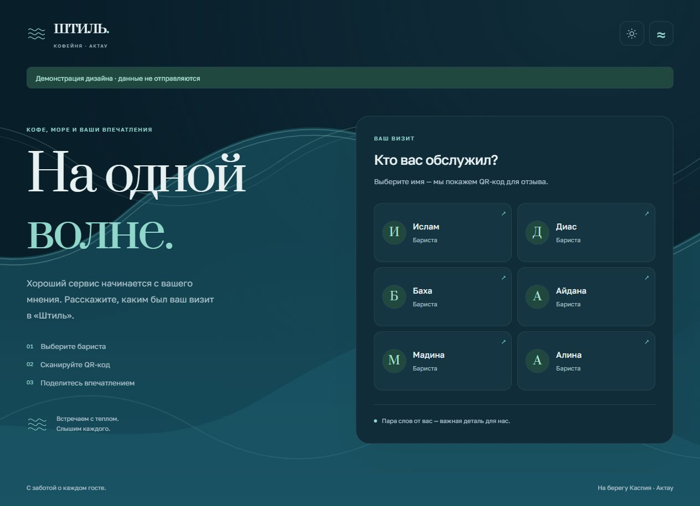
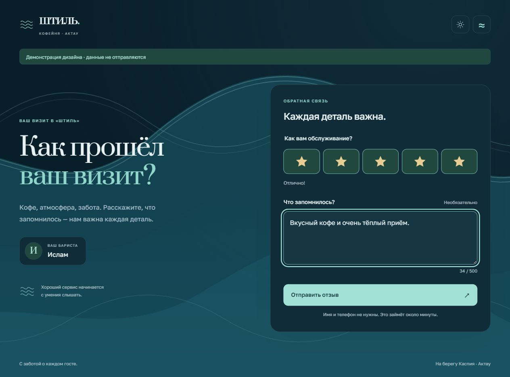

# Штиль · Отзывы гостей

Гостевой сайт кофейни «Штиль» в Актау. На экране кофейни гость выбирает бариста и получает QR-код; на телефоне оценивает сервис и оставляет комментарий. Данные поступают в существующий Google Apps Script, а [AdminFeedback](https://github.com/Yernaribadulla/AdminFeedback) показывает показатели команды.

[Открыть сайт](https://yernaribadulla.github.io/qrcode2/) · [Демо без отправки данных](https://yernaribadulla.github.io/qrcode2/?demo=1) · [Демо формы](https://yernaribadulla.github.io/qrcode2/feedback.html?staff=mukha&demo=1)

| Выбор бариста | Форма отзыва |
| --- | --- |
|  |  |

[Мобильная форма с выбранной оценкой](docs/preview-mobile.png)

## Что изменилось в 2.0

- Общая со «Штилем» палитра, шрифты Golos Text / Prata и многослойные анимированные волны Каспия.
- Светлая и тёмная темы с плавной сменой цветов, fade при входе, пауза движения и системный `prefers-reduced-motion`.
- Сотрудники видны в адаптивной сетке. Нет скрытой карусели и постоянно работающего JS-цикла прокрутки.
- QR на непрозрачном белом квадрате с полями. Генератор поставляется вместе с сайтом, без запроса к CDN. Результат декодируется в браузерном тесте.
- Автовозврат через 20 секунд, возможность продлить время, возврат фокуса к выбранному бариста и прямая ссылка на форму.
- Форма с нативными радиокнопками оценки, доступными с клавиатуры и касанием, комментарием до 500 символов и сохранением введённого текста при сетевой ошибке.
- Экран благодарности и исходные ссылки на 2ГИС, Яндекс и Instagram доступны после любой оценки.
- Ошибка сети не выдаётся за успешную отправку; повторный запрос заблокирован, пока предыдущий выполняется. Недоступный список сотрудников не подменяется вымышленными именами.

Тема и пауза используют ключи `shtil-theme` и `shtil-motion`, как AdminFeedback. На одном origin `yernaribadulla.github.io` выбор синхронизируется между сайтами и вкладками. При недоступном storage интерфейс продолжает работать.

## Запуск

Это статический сайт без сборки и серверных npm-зависимостей. Открывайте через HTTP, а не `file://`: приложение использует ES-модули.

```sh
git clone https://github.com/Yernaribadulla/qrcode2.git
cd qrcode2
npm ci
npm start
```

Сервер слушает только [127.0.0.1:4174](http://127.0.0.1:4174/). Для обычного размещения достаточно файлов репозитория; Node.js нужен только для локальных инструментов и тестов. Можно использовать `python -m http.server 8000`.

Добавьте `?demo=1` для проверки интерфейса. Демо явно отмечено, показывает демонстрационную команду, переносит параметр в QR/ссылку на форму и не выполняет запросов к Sheets, Apps Script или Метрике. Без этого параметра форма при открытии с сотрудником фиксирует настоящий скан.

## Связь с аналитикой

Настройки находятся в [src/config.js](src/config.js). Сохранены исходные spreadsheet ID, `gid=1292898986`, URL Apps Script и счётчик Метрики `110849170` на странице отзыва. Серверный код Apps Script находится вне этого репозитория и не изменялся.

| Событие | Формат запроса в прежний Apps Script |
| --- | --- |
| Открытие формы по QR | JSON `{ "barista": "mukha" }`, без `rating` |
| Отзыв | JSON `{ "barista": "mukha", "rating": 5, "comment": "…" }` |
| Переход на платформу | URL-encoded `type=platform_click&barista=mukha&platform=2gis` |

Поддерживаются `feedback.html?staff=...` и прежний `?barista=...`. QR сохраняет путь `qrcode2/feedback.html` на действующем домене. Идентификатор сотрудника формируется, как раньше: имя в нижнем регистре. Внешние строки вставляются через `textContent`. При отсутствии сотрудника сохраняется прежнее значение `unknown`; в AdminFeedback такие записи не относятся к конкретному сотруднику.

Скан защищён от повторов в одной сессии ключом `scan_logged_<имя>`. Отклонённый сетевой запрос снимает эту отметку. При заблокированном sessionStorage запись скана работает, но межстраничная дедупликация недоступна.

Apps Script по-прежнему вызывается с `mode: no-cors`. Его opaque-ответ **не позволяет подтвердить сохранение строки**. Сетевая ошибка оставляет форму для повтора; экран благодарности появляется после завершения запроса без сетевого исключения. Для подтверждения записи нужен отдельный ответ backend с разрешённым CORS; это не имитируется на клиенте.

## Проверки

```sh
npm ci
npx playwright install --with-deps chromium
npm run format:check
npm test
npm run test:browser
```

10 unit-тестов: парсинг GViz, идентификаторы, старые ссылки, схемы запросов, валидация, демо и ошибки сети. 22 браузерных сценария: реальное декодирование QR, таймер/продление, фокус, клавиатура и касание, отказ источника, повторная отправка, XSS, shared appearance, обе темы и ширины 320/390/768/1440 px. axe проверяет WCAG A/AA/2.1 AA на выборе сотрудника, QR, форме и благодарности в обеих темах. Отдельно проверен QR на экране 1280×720.

Тесты перехватывают записи в Apps Script и запросы Метрики: рабочие отзывы не создаются. Автоматические проверки доступности не заменяют ручную проверку реальных телефонов и сканеров. GitHub Actions запускает тот же набор перед завершением проверки коммита.

## Файлы

```text
index.html              Выбор бариста и QR
feedback.html           Форма и благодарность
style.css               Общая визуальная система, темы, волны, адаптивность
script.js               Загрузка команды, QR, таймер и фокус
src/bootstrap.js        Предпочтения до первой отрисовки
src/appearance.js       Переключатели темы/движения, синхронизация вкладок
src/config.js           Прежние интеграции и настройки
src/data.js             Парсинг, ссылки и контракт запросов
src/feedback.js         Оценка, комментарий, отправка, обработка ошибок
src/metrics.js          Существующая Метрика, отключённая в демо
vendor/                 QRCode.js 1.0.0 и его MIT-лицензия
tests/                  Unit и Playwright / axe / jsQR
```

Обоснование интерфейса и границы проверки: [docs/design.md](docs/design.md). Сторонний генератор QR: [vendor/qrcodejs-LICENSE](vendor/qrcodejs-LICENSE).
